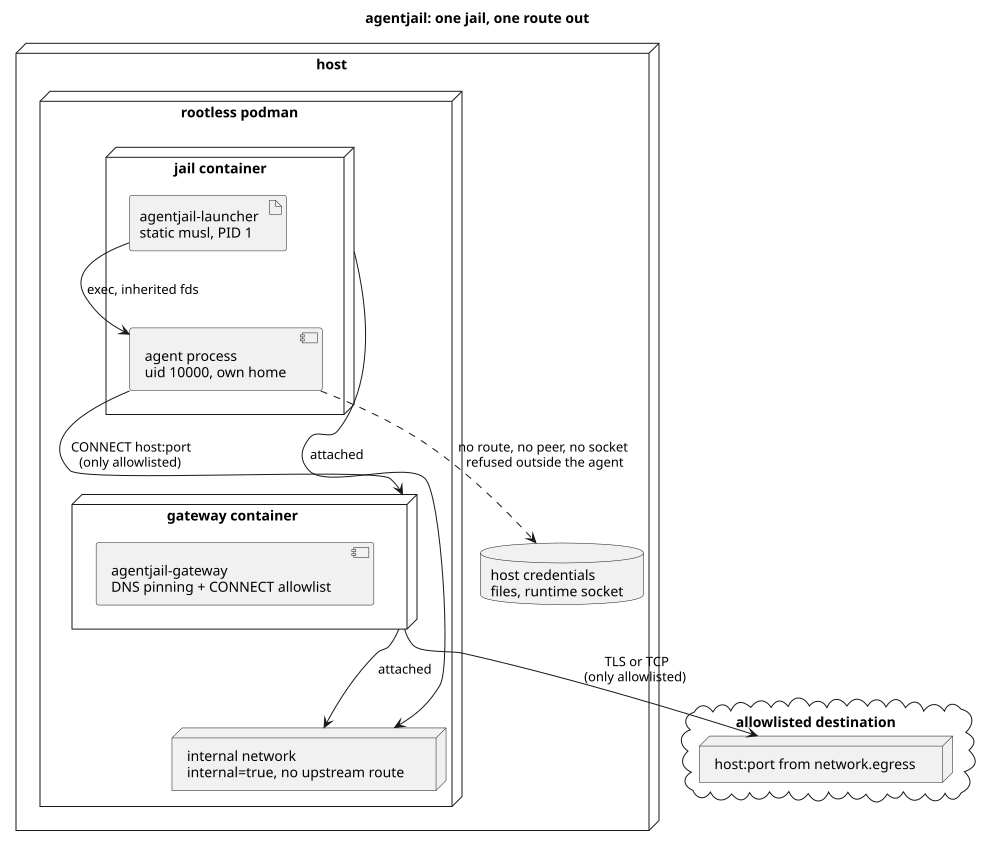

# agentjail

Run an AI coding agent — any agent — inside a rootless Podman jail with no host
secrets, no host network, its own home, and an enforced egress allowlist.



The diagram sources are in `docs/diagrams/` and the SVGs are rendered by CI from
the pinned PlantUML image (`docs/adopting.md`); [Diagrams](#diagrams) lists them
all.

An agent is a process. agentjail does not know or care whether that process is
pi, Claude Code, Codex, OpenCode, or something you wrote — it takes a command
and arguments and runs them under a policy. There is no harness-, session-, or
vendor-specific code or configuration in the product.

## What it is

- A **launcher**: `agentjail run <profile> -- <agent command…>` starts the jail,
  forwards the transport described below, and exits with the agent's exit code.
- A **profile format**: TOML parsed into typed structs with fail-closed
  defaults, validated against `schema/profile.schema.json` and against semantic
  rules JSON Schema cannot express.
- A **trio of small binaries**: `agentjail` (CLI and policy), `agentjail-launcher`
  (stdio/signal/exit-code plumbing inside the jail), `agentjail-gateway` (the
  jail's only route out).
- A **proof harness**: `agentjail selftest [profile]` attacks its own jail and
  reports what held; `agentjail selftest --baseline` runs the same probes with no
  jail to prove each negative is real.

## What it is NOT

- **Not a VM.** It is a container: it shares the host kernel. A kernel or
  runtime escape is outside any guarantee this provides.
- **Not a securer of last resort.** If the host user, the host kernel, the
  model provider, or the agent's own supply chain is already compromised, this
  is not the control that saves you. See `docs/threat-model.md`.
- **Not a secret manager.** agentjail never stores, encrypts, or rotates your
  credentials. It reads them from where they already live (an environment
  variable, a file, a credential store) by reference and injects them into the
  agent process. It never writes them into the image or a bind mount.
- **Not a reimplementation of isolation.** Podman/crun does the containment;
  agentjail is policy and plumbing around it. There is no runc/youki or
  OCI-syscall work here.
- **Not a proxy you can trust from inside.** An allowlist a jailed process can
  bypass by ignoring `HTTPS_PROXY` is not enforcement. The boundary is the
  network: an internal network with no route, where the gateway is the only
  peer. Three egress classes (`model`, `external`, `internal`) make that
  boundary concrete; see `docs/egress-classes.md`.

## The single-route invariant

The jail's **only** route off its own network is the gateway. A hostname
allowlist is decorative the moment any other route exists: **if the agent can
send packets to a raw IP address, DNS pinning buys nothing.**

That is a property of the network, so it is verified — never assumed:

- **Outside**: the target network's own metadata must say `internal: true`, with
  a subnet and no upstream route (`podman network inspect`). A profile naming a
  bridged network is refused with an error, not a warning and not a
  start-then-kill.
- **Inside**: from within the jail, the only reachable peer must be the
  gateway, and no other peer or route may exist.
- Both checks run on **every start**, not once per profile install, because
  networks change under you. `run` and `doctor --network` call the **same**
  verification function (`crates/agentjail-core/src/network.rs`); there is no
  second implementation to drift.

## Quickstart

```sh
# 1. Validate a profile against the schema and semantic rules (works today).
cargo run -p agentjail -- profile validate profiles/minimal.toml

# 2. See the effective profile with every default resolved (works today).
cargo run -p agentjail -- profile show profiles/allowlist.toml
```

Host diagnostics are real and read-only, including the outside half of the
single-route invariant for any existing network:

```sh
cargo run -p agentjail -- doctor
cargo run -p agentjail -- doctor --network podman        # refusal: not internal
```

`run` works for the default posture, no egress. It attaches to the internal
network named in the profile, verifies that network on every start, and `exec`s
podman so stdio, signals and the exit code pass through:

```sh
podman network create --internal agentjail-minimal
cargo run -p agentjail -- run profiles/minimal.toml -- bash -lc 'id -u'
podman network rm agentjail-minimal
```

`network.mode = "allowlist"` profiles are refused until the egress gateway
lands: the error says so. The selftest runs in both modes (see "Evidence" below).

The gateway parses and prints its allowlist but does not proxy yet:

```sh
cargo run -p agentjail-gateway -- --config gateway/classes/model.toml --check
```

## Audit after a run

The gateway's `-` destinations are its container's own stdout/stderr, and the
run removes the container, so that evidence goes with it. `run` therefore gives
every run two files under the state directory `agentjail doctor` already
reports (`$XDG_STATE_HOME/agentjail`, default `~/.local/state/agentjail`):

```text
<state>/audit/<class>/<jail-id>.audit.log
<state>/audit/<class>/<jail-id>.dns.log
```

They are written by the gateway container through a writable bind mount of that
per-run directory; the class config is untouched. The documented command reads
them back after the container is gone:

```sh
agentjail audit --class model
```

Files are read newest run first and the merged view is in time order. `run`
keeps the **newest 20 runs per class** and prunes older ones at start, removing
a run's two files together. Gateway containers also carry
`io.agentjail.class` and `io.agentjail.jail` labels, so `podman ps` is legible
while the run is live.

## Profiles at a glance

```toml
version = 1
workdir = "/work"
home = "/home/agent"            # required, never defaulted

[image]
name = "localhost/agentjail-base:1"
digest = "sha256:…"             # required: tags are labels, digests are pins

[network]
mode = "allowlist"              # required; "none" is the safe posture, not a default
dns = "gateway"                 # required; no accidental inheritance
# name = "existing-internal-network"   # optional; verified on every start

[[network.egress]]
host = "api.example.com"
port = 443

[[secrets]]
source = "env"                  # or "file" or "store"; never an inline value
ref = "EXAMPLE_FORGE_TOKEN"
target = "EXAMPLE_FORGE_TOKEN"

[agent]
command = "my-agent"            # any executable; agentjail is agent-agnostic
args = ["--mode", "rpc"]
```

Two complete examples live in `profiles/minimal.toml` (no egress) and
`profiles/allowlist.toml` (one destination, through the `model` egress class).
The full reference is `docs/profiles.md`; egress classes are in
`docs/egress-classes.md`.

```sh
# Build the only two images a run needs (both are local; nothing is published).
podman build -f images/base/Containerfile -t localhost/agentjail-base:1 images/base
cargo build --locked --release --target x86_64-unknown-linux-musl -p agentjail-gateway
scripts/build-gateway-image.sh          # prints the tag it built

# Run a jail that may reach exactly one destination.
agentjail run profiles/allowlist.toml -- bash -l
```

The gateway is tagged per workspace (`localhost/agentjail-gateway:ws-…`, derived
from the workspace's path), not with one mutable tag shared by the machine: two
checkouts that build it from different code must not overwrite each other's
gateway. `run` derives the same tag; `AGENTJAIL_GATEWAY_IMAGE` names one
explicitly, which is what an installed layout or a published image uses.

`run` hands the gateway the **intersection** of the class allowlist and the
profile's `network.egress`, and that intersection is the grant: a profile that
lists one destination reaches that one, not everything its class happens to
allow. The same grant is the jail's DNS answer set (a name the profile did not
ask for is `NXDOMAIN`), a refusal says which side refused it (`reason=`
`not-in-profile` or `not-in-class`), and `agentjail profile show` prints the
grant. A profile that lists no destination gets a gateway that permits nothing,
and the run says so out loud instead of refusing to start.
```

The egress class is decided by the internal network the jail joins, and the
gateway for that class is the jail's only peer. A process that ignores the proxy,
dials a raw `IP:port`, or resolves a name and connects to it **fails closed** —
that is the control working, not a bug.

## Status

Spelled out plainly:

| Piece | State |
| --- | --- |
| Typed profile model, JSON Schema validation, semantic rules, specific errors | **implemented** |
| `profile validate`, `profile show` | **implemented** |
| `doctor`, including the outside network-invariant check (`--network NAME`) | **implemented** |
| CLI wiring, exit codes, help text, launcher/selftest contracts | **implemented** |
| `agentjail-launcher`: pipes, SIGINT/SIGTERM/SIGQUIT + resize forwarding, exit codes, root refusal, 3-turn JSON-RPC over pipes | **implemented** and tested |
| `run` with `network.mode = "none"` (hardened podman argv, secret-store injection, outside network check, `exec` passthrough) | **implemented** |
| `run` with `network.mode = "allowlist"`: per-run class network, class gateway container, `HTTPS_PROXY`/`ALL_PROXY` + `--dns <gateway>` + `--dns-search .`, the gateway is started with the profile's grant (`class allowlist ∩ network.egress`), both removed on every exit path | **implemented** |
| Egress gateway: DNS (`A` → loopback for class names, NXDOMAIN for the rest), CONNECT allowlist, resolve-once/check-every-answer/connect-pinned, per-jail byte budget and connection cap, one audit line per decision and per query on two separate streams (an allow at establishment with the resolved set, its byte counts when it closes or the budget cuts it) | **implemented** |
| `agentjail audit`: both gateway streams read back, merged in time order and filtered by jail, class, decision | **implemented** |
| Egress classes `model` / `external` / `internal` as three committed configs, one binary, one container per run | **implemented** |
| Operator-defined classes: `network.class_dir` + `network.class_digest`, validated with the same rules, pinned by sha256, refused when a built-in name would be shadowed; no environment override | **implemented** |
| Network lifecycle: `Drop` guard on network + gateway, dead-pid pruning only, never by profile prefix | **implemented** |
| Proofs (class beats ACL text both ways, raw IP refused, allow audited, deny logged, byte budget cuts a tunnel, connection cap refuses one) | **implemented**, run in the normal `ci` job |
| `selftest` (negative set + positive control), baseline and jailed in `ci` | **implemented** (`--baseline` proves each negative holds without a jail; jailed proves it is denied) |
| Base image (`images/base/Containerfile`) | written; not published |
| CI: `make check` (fmt, clippy `-D warnings`, workspace tests), profile validation, Containerfile checks, musl builds | **implemented**; `make check` is the same command a developer runs |
| CI: real image build | non-blocking job (external apt/npm dependency) |

Where the implementation is weaker than the design, `docs/egress-classes.md`
says so at the end: `CONNECT` only (no plain-HTTP or raw-TCP proxying), a byte
budget and connection cap that bound totals but not speed, DNS answers that are
checked but not authenticated, IPv6 egress off rather than implemented, and the
gateway image pinned by ID rather than attested. What remains reachable if the
gateway itself is compromised is stated in one place,
`docs/threat-model.md#if-the-gateway-itself-is-compromised`.

## Diagrams

Every diagram is a PlantUML source in `docs/diagrams/` with its rendered SVG
committed next to it. CI renders it with the digest-pinned PlantUML image and
fails on invalid syntax or on an SVG that no longer matches its source, so a
diagram here describes this commit and not an earlier design.

- [`deployment.svg`](docs/diagrams/deployment.svg) — the host, the per-run internal network, the jail, and the dual-homed class gateway.
- [`run-lifecycle.svg`](docs/diagrams/run-lifecycle.svg) — one `run` from the preflight to the reap: per-run network, gateway with the grant and the audit destination, jail, teardown.
- [`egress-decision.svg`](docs/diagrams/egress-decision.svg) — the grant as `profile egress ∩ class allowlist`, and why one connection is denied `not-in-profile` or `not-in-class`.
- [`audit-readback.svg`](docs/diagrams/audit-readback.svg) — the per-run audit and DNS files, and reading them back after the container is gone.
- [`launcher-sequence.svg`](docs/diagrams/launcher-sequence.svg) — the launcher transport: pipes, signals, exit code.
- [`selftest-flip.svg`](docs/diagrams/selftest-flip.svg) — the same probe failing without a jail and passing with one.

## Documentation

- [`docs/integration.md`](docs/integration.md) — integrating an agent: the
  integration model, skills (baked vs mounted), MCP server shapes, composing a
  profile, per-agent recipes, and the deployment checklist.
- [`docs/threat-model.md`](docs/threat-model.md) — assets, attacker model,
  guarantees, out-of-scope, accepted residual risks. Read this before trusting
  anything else here.
- [`docs/profiles.md`](docs/profiles.md) — the profile reference, defaults
  audit, and every validation rule.
- [`docs/cli.md`](docs/cli.md) — launcher and gateway contracts, the selftest
  design, exit codes.
- [`docs/adopting.md`](docs/adopting.md) — the adoption note: what to supply,
  one worked profile, which class per role, and what adoption does not buy.
- [`images/README.md`](images/README.md) — building the base image and adding a
  runtime.

## Evidence for the run path

**CI exercises the jail through `selftest`, not through every `run` case.** The
selftest runs in the normal `ci` job in both modes: `--baseline` needs no podman
and proves the hazards are real; jailed mode uses the same podman setup as the
egress proofs and proves they are denied. The remaining real-jail `run` tests are
`#[ignore]`d because they need rootless podman and the locally built base image,
so a green `ci` does not mean every `run` case passed. Reproduce those on a host
with rootless podman:

```sh
podman build -f images/base/Containerfile -t localhost/agentjail-base:1 images/base
cargo test -p agentjail --test run_podman -- --ignored --test-threads=1
```

The jailed selftest binds a copy of the `agentjail` binary into the jail, so the
binary must be runnable in the image. CI uses the static musl build; a locally
built dynamic binary and an older glibc image may not be compatible.

## Development

The toolchain is pinned in `rust-toolchain.toml` (1.100.0, with `clippy`,
`rustfmt`, and the `x86_64-unknown-linux-musl` target).

```sh
cargo fmt --all -- --check
cargo clippy --workspace --all-targets -- -D warnings
cargo test --workspace
cargo run -p agentjail -- profile validate profiles/minimal.toml
cargo run -p agentjail -- profile validate profiles/allowlist.toml
cargo build --release --target x86_64-unknown-linux-musl \
  -p agentjail-launcher -p agentjail-gateway

# the agent base image (CI only builds it when images/ or Cargo.lock changes)
podman build -f images/base/Containerfile -t localhost/agentjail-base:1 images/base
```

CI is a single job with no matrix: one runner boot, cargo cache, cheapest steps
first, `pull_request` and manual runs only, and the diagram/image steps gated on
changed paths. The repository is private, so billed minutes are a design
constraint (`.github/workflows/ci.yml`).

Runtime dependencies: none for the launcher, and no HTTP client anywhere — the
JSON Schema validator is built without its network resolver. All three binaries
are static-pie (CLI, launcher, and gateway), so the launcher and gateway can be
bind-mounted into a jail built from any base, including `scratch`.

## License

Apache-2.0 (the repository's `LICENSE`, from `main`).
