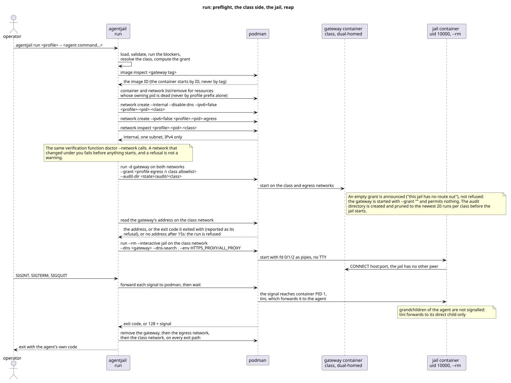

# CLI and runtime contracts

Three binaries, one workspace:

| Binary | Runs where | Job |
| --- | --- | --- |
| `agentjail` | host | policy: profile validation, preflight, doctor, launch orchestration |
| `agentjail-launcher` | inside the jail, as PID 1 | stdio/signal/exit-code plumbing around the agent |
| `agentjail-gateway` | its own container, the jail's only peer | DNS pinning and CONNECT allowlist |

The launcher and gateway are built static against musl so they can be
bind-mounted into a jail built from any base, including `scratch`.

## `agentjail run <profile> -- <agent command…>`

Implemented for `network.mode = "none"` (no egress). The build path:

- **preflight, every start**: `network.name` is required; the named network is
  inspected and verified against the single-route invariant with the same code
  path `doctor` uses. A bridged network is refused before anything is created.
- **argv**: `podman run --rm --interactive --pull=never --read-only
  --userns=keep-id:uid=10000,gid=10000 --cap-drop=ALL
  --security-opt=no-new-privileges`, the profile's `--pids-limit`, `--memory`,
  `--cpus`, `--ulimit nofile` and `--tmpfs /tmp,/run` (sized from the profile,
  `noexec,nosuid,nodev`), exactly the declared bind mounts (`ro`/`rw`, `Z` when
  SELinux is enforcing), an **environment allowlist** (`HOME`, `TERM`, profile
  literals; no host environment), `--workdir`, the digest-pinned image, and the
  agent command. There is no `-t`, no host home, no runtime socket, and no
  implicit mount.
- **secrets**: references are resolved before start (an unset or unreadable
  reference fails closed, naming the reference and never a value), then written
  to podman's secret store and passed as `--secret source=…,type=env,target=…`,
  so the value is an env var at start and never appears in the container's
  `Env` list. `--no-secrets` injects none.
  - Entries are named **per run** (`agentjail-<profile>-<pid>-<target>`), so two
    concurrent runs of the same profile never share or prune each other's entry.
  - **Guarantee**: entries this run created are removed when `agentjail` exits —
    normal exit, non-zero exit, forwarded signal, or panic. A `SIGKILL` of
    `agentjail` (or a host crash) cannot be caught: those entries remain until
    the next run of the same profile prunes dead-pid entries as a backstop. A
    `source = "store"` entry belongs to the user and is never removed.
- **exec vs supervise**: with no secrets to clean up, `agentjail` calls
  `exec(podman …)`, so stdio, signals, and the exit code pass through with no
  wrapper. When it created secret-store entries it supervises podman instead:
  it forwards SIGINT/SIGTERM/SIGQUIT, waits for podman, removes the entries, and
  exits with the same code (or 128 + signal).
- **home**: the rootfs is read-only, so `run` mounts writable scratch at the
  parent of `home` and the image entrypoint creates `$HOME` with **mode 0700**
  owned by the jail uid. `home` must be a subdirectory (for example
  `/home/agent`), not directly under `/`.
- `network.mode = "allowlist"` is refused at validation and at run: the gateway
  is the next increment, and the message says so.

### Transport (a requirement, not a nicety)

The agent runs with **pipes, not a TTY**:

- stdin and stdout are a pair of pipes, so a JSON-RPC session over inherited fd
  0/1 works unchanged. There is no pseudo-terminal in the path.
- stderr is a **separate** stream and is never merged into stdout, so it cannot
  corrupt a structured protocol on stdout.
- EOF on stdin is propagated into the jail (no half-open pipe that keeps the
  agent waiting).
- terminal resize events are forwarded when the caller has a terminal, and
  ignored cleanly when it does not.

This is what a host harness needs: a container turns sockets into pipes, so the
pipes/SIGTERM/exit-code/resize path decides whether adoption is possible at all.
`crates/agentjail-launcher/tests/transport.rs` already drives a line-framed
JSON-RPC peer through the launcher for three round trips, closes stdin, and
asserts a clean shutdown and exit code; it also covers SIGINT, SIGTERM,
SIGQUIT, and SIGWINCH forwarding. The remaining acceptance test is the same
session **inside the jail**, which needs the run path.




### Signals and exit codes

`SIGINT`, `SIGTERM`, and `SIGQUIT` received by `agentjail` are forwarded to the
agent's process group; `SIGWINCH` is forwarded as a resize. The container is
removed on **every** exit path — normal exit, signal, launcher crash — so no
jail, network, or tmpfs is orphaned.

| Situation | Exit code |
| --- | --- |
| Agent exits normally | the agent's exit code |
| Agent dies from signal *N* | `128 + N` |
| Profile invalid or missing | `1` |
| Single-route invariant fails | `1`, with a refusal message, before anything starts |
| Usage error | `2` |
| Not implemented yet (increment 1) | `3` |

`--no-secrets` launches without resolving any `secrets[]` entry; the jail runs
with the profile's literal environment only.

### `agentjail-launcher`

The launcher is implemented and tested (`crates/agentjail-launcher`). Inside the
jail it:

1. refuses to run the agent as root (`AGENTJAIL_ALLOW_ROOT=1` exists only for
   tests and image builds);
2. execs the agent with inherited stdio, in its own process group;
3. forwards SIGINT/SIGTERM/SIGQUIT/SIGWINCH to that group;
4. exits with the agent's exit code, mapping death-by-signal *N* to `128 + N`.

## The single-route invariant

The jail's only route off its own network is the gateway: an internal network
with no route, with the gateway as the sole attached peer. **A hostname
allowlist is decorative the moment any other route exists; if the agent can
packet-to-IP, DNS pinning buys nothing.**

Verification happens from both sides and is fail-closed:

| Side | What is checked | Where |
| --- | --- | --- |
| Outside | the network's metadata: `internal: true`, a subnet, no upstream route | implemented: `agentjail_core::network::verify_inspect_json`, used by `doctor --network` and by `run` preflight |
| Inside | the only reachable peer is the gateway; no other peer, interface, or route exists | designed and specified below; **not implemented** (needs the run path) |

Both run on **every start** — networks change under you — and both share one
implementation of the outside check. `run` refuses a network that fails, with
an error:

```text
agentjail: error: refusing to launch: the network named by this profile does not
satisfy the single-route invariant.
  network "bridged" is not internal; the jail would have a route off its own
  network, so an egress allowlist could be bypassed by talking to a raw IP.
  Refusing to launch.
```

There is no "warning and continue" mode and no start-then-kill. A profile can
name an existing network (`network.name`); if it names a bridged one, `run`
refuses. When nothing is named, the launcher must create a dedicated internal
network and verify it the same way before starting anything.

## `agentjail selftest <profile>`

The selftest is the acceptance evidence: it attacks its own jail and asserts
what held. Every check runs **twice in the same test file** — once against the
pre-jail baseline and once inside the jail — and must fail on the baseline and
pass in the jail. A check that cannot tell the two apart is a bug in the check,
not a pass.

### Negative set (must be denied)

| Check | Denial expected |
| --- | --- |
| Raw IP:port | A direct connection to an external address fails: DNS pinning buys nothing if the agent can packet-to-IP. |
| Second route/peer | Adding a route, bringing up an interface, or attaching a peer from inside fails (no `NET_ADMIN`, no ability to change the jail's own network). |
| Bridged network | `run` handed a profile naming a non-internal network refuses with a clear message. |
| Gateway-only | From inside, the only reachable peer is the gateway. |
| Host credentials | A host-only credential file is unreadable and a host environment variable is absent. |
| Host filesystem | No host path is writable by default; only declared mounts exist. |
| Unlisted destinations | No unlisted destination connects and no unlisted name resolves. A denied destination fails fast with a connection error, not a timeout. |
| Container control | No podman or Docker socket, and no host control socket, is reachable from inside. |
| Escape | No `/proc/1/root`, no host `/proc`, no `CAP_SYS_ADMIN`, no new mount inside. |
| Concurrent jails | Two jails on distinct networks and homes cannot see each other's files, sockets, or credentials. |
| Resource limits | CPU, memory, pids, open files, tmpfs size, and writable-layer size are each enforced, not merely declared. |

### Positive control (must succeed)

Exactly one call to **one allowlisted destination** succeeds and returns a
well-formed response. If the positive control fails, a negative that also failed
proves nothing.

### Timing

A `mode = "none"` jail is expected to fail at connect time with an immediate
connection error (no hang, no long timeout). Observed on the development host
while writing this increment: `curl` exits 6 with `Could not resolve host:
api.github.com` in well under a second, because an isolated network has no
resolver. The expected signature is recorded with the test so a regression that
turns a fast refusal into a slow timeout is visible.

## `agentjail-gateway`

Implemented today: load the profile through the typed model, require
`network.mode = "allowlist"`, and print the exact allowlist and DNS strategy
(`--check`, exit 0). **Not implemented:** the listener, CONNECT handling, and
DNS pinning — the binary says so and exits 3.

The intent, documented so the implementation cannot drift: one process, DNS
answers only for allowlisted names, CONNECT only for allowlisted `host:port`,
no wildcards, no suffix matching, no dynamic widening at runtime, logs record
destination and verdict but never payload.

## In this increment

`run` and `selftest` validate the profile, run the outside network preflight
when the profile names a network, print the resolved plan, and exit `3`. They
do not start containers, do not touch the host, and do not pretend to have
tested anything.
