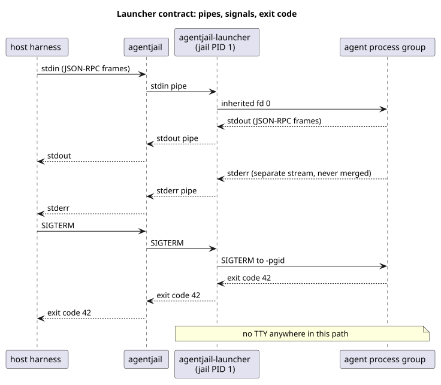

# CLI and runtime contracts

Three binaries, one workspace:

| Binary | Runs where | Job |
| --- | --- | --- |
| `agentjail` | host | policy: profile validation, preflight, doctor, launch orchestration |
| `agentjail-launcher` | inside the jail, as PID 1 | stdio/signal/exit-code plumbing around the agent |
| `agentjail-gateway` | its own container, the jail's only peer | DNS pinning and CONNECT allowlist |

The launcher and gateway are built static against musl so they can be
bind-mounted into a jail built from any base, including `scratch`.

## `agentjail run <profile> -- <agent command…>`

Implemented for `network.mode = "none"` (no egress). The build path:

- **preflight, every start**: `network.name` is required; the named network is
  inspected and verified against the single-route invariant with the same code
  path `doctor` uses. A bridged network is refused before anything is created.
- **argv**: `podman run --rm --interactive --pull=never --read-only
  --userns=keep-id:uid=10000,gid=10000 --cap-drop=ALL
  --security-opt=no-new-privileges`, the profile's `--pids-limit`, `--memory`,
  `--cpus`, `--ulimit nofile` and `--tmpfs /tmp,/run` (sized from the profile,
  `noexec,nosuid,nodev`), exactly the declared bind mounts (`ro`/`rw`, `Z` when
  SELinux is enforcing), an **environment allowlist** (`HOME`, `TERM`, profile
  literals; no host environment), `--workdir`, the digest-pinned image, and the
  agent command. There is no `-t`, no host home, no runtime socket, and no
  implicit mount.
- **secrets**: references are resolved before start (an unset or unreadable
  reference fails closed, naming the reference and never a value), then written
  to podman's secret store and passed as `--secret source=…,type=env,target=…`,
  so the value is an env var at start and never appears in the container's
  `Env` list. `--no-secrets` injects none.
  - Entries are named **per run** (`agentjail-<profile>-<pid>-<target>`), so two
    concurrent runs of the same profile never share or prune each other's entry.
  - **Guarantee**: entries this run created are removed when `agentjail` exits —
    normal exit, non-zero exit, forwarded signal, or panic. A `SIGKILL` of
    `agentjail` (or a host crash) cannot be caught: those entries remain until
    the next run of the same profile prunes dead-pid entries as a backstop. A
    `source = "store"` entry belongs to the user and is never removed.
- **exec vs supervise**: with no secrets to clean up, `agentjail` calls
  `exec(podman …)`, so stdio, signals, and the exit code pass through with no
  wrapper. When it created secret-store entries it supervises podman instead:
  it forwards SIGINT/SIGTERM/SIGQUIT, waits for podman, removes the entries, and
  exits with the same code (or 128 + signal).
- **home**: the rootfs is read-only, so `run` mounts writable scratch at the
  parent of `home` and the image entrypoint creates `$HOME` with **mode 0700**
  owned by the jail uid. `home` must be a subdirectory (for example
  `/home/agent`), not directly under `/`.
- **allowlist (`network.mode = "allowlist"`, `network.class = "…"`)**: before the
  jail exists, `run` creates the per-run internal network
  `agentjail-<profile>-<pid>-<class>`, verifies it with the same invariant as
  above (including **IPv6 off**: a class network reporting `ipv6_enabled: true`
  is refused), creates the gateway's own egress leg
  `agentjail-<profile>-<pid>-egress` (its own network, not the host's shared
  `podman` bridge), starts that class's gateway container on both
  (`--cap-drop=ALL --cap-add=NET_BIND_SERVICE`, read-only, the committed class
  config mounted read-only), and reads its address back. The jail then gets
  `--network <class network> --dns <gateway> --dns-search .` and `HTTPS_PROXY` /
  `ALL_PROXY` (and the lowercase spellings) pointing at the gateway. The jail has
  no other route and no other resolver; see `docs/egress-classes.md`. The
  profile's `egress` must be a subset of its class allowlist, and the difference
  is refused before anything is created. Both networks and the gateway are
  removed on every exit path by the same `Drop` guard that removes secret
  entries (container, then networks in reverse creation order); a `SIGKILL`
  leaves them for the next run of the same profile to prune by dead pid.
  `AGENTJAIL_EGRESS_NETWORK` names an existing network for the gateway's leg
  instead of creating one (the proof script uses it).

### Transport (a requirement, not a nicety)

The agent runs with **pipes, not a TTY**:

- stdin and stdout are a pair of pipes, so a JSON-RPC session over inherited fd
  0/1 works unchanged. There is no pseudo-terminal in the path.
- stderr is a **separate** stream and is never merged into stdout, so it cannot
  corrupt a structured protocol on stdout.
- EOF on stdin is propagated into the jail (no half-open pipe that keeps the
  agent waiting).
- terminal resize events are forwarded when the caller has a terminal, and
  ignored cleanly when it does not.

This is what a host harness needs: a container turns sockets into pipes, so the
pipes/SIGTERM/exit-code/resize path decides whether adoption is possible at all.
`crates/agentjail-launcher/tests/transport.rs` already drives a line-framed
JSON-RPC peer through the launcher for three round trips, closes stdin, and
asserts a clean shutdown and exit code; it also covers SIGINT, SIGTERM,
SIGQUIT, and SIGWINCH forwarding. The remaining acceptance test is the same
session **inside the jail**, which needs the run path.




### Signals and exit codes

`SIGINT`, `SIGTERM`, and `SIGQUIT` received by `agentjail` are forwarded to the
agent's process group; `SIGWINCH` is forwarded as a resize. The container is
removed on **every** exit path — normal exit, signal, launcher crash — so no
jail, network, or tmpfs is orphaned.

| Situation | Exit code |
| --- | --- |
| Agent exits normally | the agent's exit code |
| Agent dies from signal *N* | `128 + N` |
| Profile invalid or missing | `1` |
| Single-route invariant fails | `1`, with a refusal message, before anything starts |
| Usage error | `2` |

`--no-secrets` launches without resolving any `secrets[]` entry; the jail runs
with the profile's literal environment only.

### `agentjail-launcher`

The launcher is implemented and tested (`crates/agentjail-launcher`). Inside the
jail it:

1. refuses to run the agent as root (`AGENTJAIL_ALLOW_ROOT=1` exists only for
   tests and image builds);
2. execs the agent with inherited stdio, in its own process group;
3. forwards SIGINT/SIGTERM/SIGQUIT/SIGWINCH to that group;
4. exits with the agent's exit code, mapping death-by-signal *N* to `128 + N`.

## The single-route invariant

The jail's only route off its own network is the gateway: an internal network
with no route, with the gateway as the sole attached peer. **A hostname
allowlist is decorative the moment any other route exists; if the agent can
packet-to-IP, DNS pinning buys nothing.**

Verification happens from both sides and is fail-closed:

| Side | What is checked | Where |
| --- | --- | --- |
| Outside | the network's metadata: `internal: true`, a subnet, no upstream route | implemented: `agentjail_core::network::verify_inspect_json`, used by `doctor --network` and by `run` preflight |
| Inside | the only reachable peer is the gateway; a raw `IP:port` and a direct dial fail | implemented for allowlist profiles: `scripts/prove-egress-classes.sh` (proofs 2 and 3) asserts it from inside a real jail on every PR |

Both run on **every start** — networks change under you — and both share one
implementation of the outside check. `run` refuses a network that fails, with
an error:

```text
agentjail: error: refusing to launch: the network named by this profile does not
satisfy the single-route invariant.
  network "bridged" is not internal; the jail would have a route off its own
  network, so an egress allowlist could be bypassed by talking to a raw IP.
  Refusing to launch.
```

There is no "warning and continue" mode and no start-then-kill. A `mode = "none"`
profile names an existing network (`network.name`); if it names a bridged one,
`run` refuses. An allowlist profile names no network: `run` creates a dedicated
internal one and verifies it the same way before starting anything.

## `agentjail audit`

Reads the gateway's two streams back: the audit stream (one line per connection
decision) and the DNS stream (one line per query), merged in time order and
filtered. This is the incident view; the streams themselves, their destinations,
rotation and retention are described in `docs/egress-classes.md`.

```sh
agentjail audit --class model                          # both streams of a class
agentjail audit --class model --jail proof-1 --decision deny --tail 50
agentjail audit --audit a.log --dns d.log --stream dns
podman logs agentjail-proof-1-gateway | agentjail audit --audit -   # captured stream
agentjail audit --class bot --class-dir /srv/classes --class-digest sha256:1f0c…
```

| Flag | Meaning |
| --- | --- |
| `--class <class>` | read the streams configured for that class (`audit_log`, `dns_log`) and filter on that class |
| `--class-dir <dir>` + `--class-digest <sha256:…>` | read them from an operator class file in `<dir>`, pinned by digest — the same pair a profile uses |
| `--audit <path>` / `--dns <path>` | read these files instead; `--audit -` reads stdin |
| `--jail <id>` | only lines whose `jail=` field is exactly this |
| `--decision <d>` | only lines with this decision: `allow`, `allow-close`, `deny` (audit) or `answer`, `nxdomain`, `refused`, `drop` (DNS) |
| `--stream audit` or `dns` | only one stream |
| `--tail <n>` | only the last N matching lines |

Output keeps the line the gateway wrote and prefixes it with the stream it came
from (`stream=audit ts=… decision=deny reason=byte-budget budget=4096 …`), so a
merged view is still evidence rather than a re-rendering. A stream configured as
`-` went to the runtime's log rather than a file: `audit` says so instead of
printing nothing, because "no lines" and "not captured" look identical otherwise.

## `agentjail selftest [profile]`

The selftest is the acceptance evidence: it attacks its own jail and asserts
what held. It has **one harness and two executors**, and the assertion functions
are the same in both:

| Mode | Where the probe runs | What it must show |
| --- | --- | --- |
| `agentjail selftest --baseline` | a plain host process; no podman, no jail | every negative **holds** (the hazard is real), or the assertion is weak |
| `agentjail selftest` | inside a real jail created by the `run` path | every negative is **denied**, and the positive control answers |

The probe is the hidden `agentjail __probe` subcommand, run from a copy of the
same binary bind-mounted read-only into the jail. That is deliberate: if the two
modes were separate implementations, a jailed pass would prove only that the
second implementation works. The binary must be runnable inside the jail image;
CI uses the static musl build, and a supplied profile's image must be compatible
with the host binary otherwise.

The optional profile selects the **image, workdir and home**. The selftest
generates its own profile with fixed limits (`128m` memory, `64` pids, `128`
open files), its own internal network and class gateway, and its own agent
command. It does **not** carry the supplied profile's mounts, secrets, `env`,
egress list or resource numbers into the jail. Those are exercised by
`run`/`profile` tests and by `scripts/prove-egress-classes.sh`; the selftest is
about the jail posture, not about replaying one user profile.

### Exit semantics

`--baseline` exits `0` when every negative case correctly **held** without a
jail (the host secret was readable, the destination was reachable, network
changes succeeded, the limits were not enforced, `NET_ADMIN` was available). It
exits non-zero and **names** any negative that was already denied without a
jail: that is a weak or fake assertion, not a pass. A case that cannot run in
baseline mode is printed as `SKIPPED-BASELINE` with the reason and is not
counted as a pass.

Jailed mode exits `0` when every negative was denied **and** the positive
control answered through the proxy with its audit line. It exits non-zero and
names the case that did not.

A setup failure (missing podman, missing gateway or target image, a failed
`agentjail run`) is reported as a failure of the jailed cases with the setup
error in `observed`; it is never silently skipped.

Per case, both modes print:

```text
case=<name> mode=<baseline|jailed> expected="…" observed="…" verdict=<EXPECTED|PASS|FAIL|SKIPPED-BASELINE>
```

`--json` prints `{mode, ok, cases:[{case, mode, expected, observed, verdict}],
failing_cases}`.

### Cases

| Case | Baseline | Jailed | What it proves |
| --- | --- | --- | --- |
| `host-secret` | a host file and a host environment variable are readable | both are unreachable (`ENOENT`, env absent) | no ambient host credentials and no host environment by default |
| `outside-allowlist` | a destination outside the allowlist is reachable | direct dial fails and the proxy returns `403` | the allowlist is enforced by the network, not by an environment variable |
| `raw-ip` | a raw `IP:port` is reachable | direct dial fails and CONNECT to an IP literal is refused | DNS pinning cannot be bypassed by packet-to-IP |
| `network-control` | a plain process can add a route, create an interface and attach a veth peer | all three fail with `EPERM` | the jail cannot alter its own network namespace (no `NET_ADMIN`) |
| `jail-isolation` | `SKIPPED-BASELINE`: no jail exists, so there are not two | two concurrent jails cannot see each other's marker files or unix socket; each sees only its own injected id | jails do not share homes, sockets or injected environment |
| `resource-limits` | the configured memory, pids and nofile limits are **not** enforced | nofile opens fail at `128`, child fork fails at `64`, a 256 MiB allocation is OOM-killed (`signal:9`) | the limits are enforced by the runtime, not merely printed in the profile |
| `net-admin` | `CAP_NET_ADMIN` is available | `CAP_NET_ADMIN` is absent (`CapEff`) | the capability that would let the agent change the network is dropped |
| `positive-control` | `SKIPPED-BASELINE`: no proxy or gateway audit stream exists | one allowlisted destination answers through the proxy and `decision=allow` appears on the audit stream | a negative that failed proves nothing unless a permitted call still works |

`network-control` in baseline mode creates a fresh user and network namespace
first. An ordinary unprivileged host process has no `NET_ADMIN` in the init
namespace, so without that step the baseline would fail for the wrong reason
("the host user was unprivileged"), not because the jail is absent. The jailed
probe does **not** get that step: it attempts the same netlink operations in the
jail's own namespace. On a host that blocks unprivileged user namespaces
(Ubuntu 24.04's AppArmor restriction, for example) baseline `network-control`
reports the namespace as unavailable and fails honestly; the CI step lifts that
runner restriction first.

`jail-isolation`'s credential part is the weakest of the eight: it proves each
jail sees only its own injected `PEER_ID` and not the other's, not that a shared
credential store is partitioned in every failure mode. `docs/threat-model.md`
says so beside the guarantee.

### What the selftest does not cover

- It is not a kernel-escape test: it does not try `CAP_SYS_ADMIN`, mount
  escapes, `/proc/1/root`, or container-runtime bugs.
- It does not test the gateway's own outbound leg, a real external destination,
  or the committed class allowlists; the fixture destination is a local
  container and the class config is generated for the run.
- It does not replay the supplied profile's mounts, secrets, `env` or egress
  list.
- It does not test concurrent-session transport, signals, or resize; those
  belong to the launcher tests.
- The positive control is one TLS-less `CONNECT` to a fixture that answers
  immediately; it is evidence that the proxy path works, not a production
  destination test.

## `agentjail-gateway`

One instance per egress class, driven entirely by one committed class config:

```sh
agentjail-gateway --config gateway/classes/model.toml --jail-id <profile>-<pid>
agentjail-gateway --config gateway/classes/model.toml --check   # print, start nothing
```

- **DNS (UDP)**: `A` answers `127.0.0.1` for names the class may reach, NXDOMAIN
  for everything else. Loopback is deliberate — a jail that resolves and then
  dials directly reaches itself and fails closed.
- **CONNECT (TCP)**: relays only `host:port` pairs on the allowlist; exact host or
  `*.suffix`, port part of the match. A raw `IP:port` is refused even if listed,
  and a non-CONNECT request gets `405`, logged in the same shape as a denial.
  The name is resolved **once**, **every** answer is checked against the class
  `address_policy`, and the tunnel goes to a checked address — one blocked answer
  refuses the whole name.
- **Limits**: each jail has `max_bytes` (both directions) and `max_connections`
  from its class config; both are required, and reaching either refuses and logs
  with the counters (`reason=byte-budget budget=…`, `reason=connection-cap
  connections=…/…`, `429` for the cap).
- **Logging**: one audit line per decision (including denials) on a stream
  separate from the DNS log, with the class, the jail id, the destination, the
  decision, and the bytes. An allowed connection logs `decision=allow` when it is
  established (with `resolved=` and `pinned=`) and `decision=allow-close` with the
  byte counts when it ends — or `decision=deny reason=byte-budget` when the budget
  cut it. A panic in the proxy itself is `decision=deny reason=internal-error`,
  so an errored proxy never looks like a connection that never happened.

`--check` prints the listeners, the budget, the cap, the address policy and the
allowlist, and starts nothing.

Full detail, including the audit line format, rotation and retention, and the
residual weaknesses: `docs/egress-classes.md`. The proofs in
`scripts/prove-egress-classes.sh` run on every PR.

