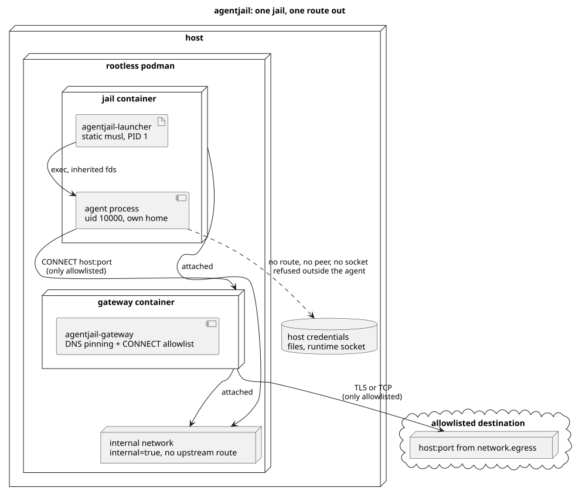

# Threat model

This document is deliberately short and deliberately blunt. It exists to stop
agentjail from overclaiming, and to make the design choices that follow
reviewable against a stated attacker.

## Assets, in priority order

1. **Host credentials outside the jail**: SSH keys, cloud and registry tokens,
   browser and keychain stores, credential-store entries, host environment
   variables.
2. **Host files**: everything the jail was not explicitly given, including the
   user's other repositories, mail, and documents.
3. **Host control surfaces**: the container runtime socket, the user's D-Bus
   and systemd session, `/proc` and `/sys`, and the network namespace of the
   host.
4. **Other jails**: a second agent's workspace, credentials, and sockets.
5. **The declared workspace**: the one path the user *did* grant, writable only
   when a profile says `read_only = false`. Damage here is expected and must
   stay here.
6. **The user's egress budget and identity**: outbound calls made under the
   user's credentials, and the destinations they reach.

## Attacker model

The defender assumes the agent **inside** the jail is hostile:

- it may be compromised through a malicious dependency, a malicious repository,
  or a hostile issue/PR it reads;
- it may be prompt-injected by content it was asked to process, so its *goals*
  are untrusted even though its code is legitimate;
- it is assumed to be able to run arbitrary commands as the jailed uid 10000,
  to forge or ignore environment variables, and to try to resolve and contact
  arbitrary destinations;
- it is assumed to know the profile (profiles are not secrets).

The attacker does **not** have code execution on the host outside the jail, and
does not already control the runtime or the kernel.

## In scope: what agentjail is supposed to guarantee

For the jailed process, and assuming a correct rootless Podman installation:

1. **No ambient host credentials.** Only `secrets[]` references resolve, and
   their values are injected into the agent process environment (or a
   size-limited tmpfs file), never written into the image, a bind mount, or the
   jail filesystem. `agentjail run --no-secrets` must remain expressible and
   drops all of them.
2. **No host filesystem by default.** The jail sees the image plus the
   explicitly declared mount targets. Nothing else is bind-mounted; the
   container root filesystem is not the host root.
3. **No host control surfaces.** No container runtime socket, no host D-Bus,
   no host `/proc`, no host network namespace.
4. **One route out, and only one.** The default network model is
   `mode = "none"`: the jail sits on an internal network with no route out and
   no resolver. With `mode = "allowlist"` the only way out is the egress
   gateway, and the gateway permits only the listed `host:port` destinations.
   This is the single-route invariant, stated and enforced separately below.
5. **No inherited DNS search domains.** Whenever the jail has a resolver
   (`mode = "allowlist"`), the launcher passes `--dns-search .`, an empty search
   list, so a host search domain cannot turn a short or unqualified name into an
   internal address. With `mode = "none"` there is no resolver at all — Podman
   rejects DNS options together with an isolated network, so there is nothing to
   inherit. This is a security property, not a convenience: a resolver that
   answers `build-server` from a host search domain silently defeats the
   allowlist.
6. **Bounded resources.** CPU, memory, pids, open files, tmpfs sizes, and the
   writable layer size are declared in the profile and enforced by the runtime,
   not merely printed.
7. **Isolation between jails.** Two concurrent jails use distinct container
   names, networks, and homes, and cannot read each other's files, sockets, or
   credentials.
8. **A predictable launcher.** Stdio is pipes (not a TTY), signals and terminal
   resize are forwarded, the agent's exit code is propagated, and the container
   is removed on every exit path. A harness that speaks JSON-RPC on inherited
   fd 0/1 can run inside the jail without a wrapper.

The negative tests for 1–7, the single-route negatives, and the positive control
for 4 are the `agentjail selftest` contract in `docs/cli.md`. Until that is
implemented, these are **design guarantees, not verified ones**, with two
exceptions that do work today: the entity/format validation of a profile, and
the outside half of the single-route invariant as exercised by
`doctor --network` and by `run` preflight (see Status in the README).

## Trust boundaries

Solid relationships are the only permitted paths; the dashed dependency is the
one the design forbids and the environment must make impossible.

## The single-route invariant

**The jail's only route off its own network is the gateway**: an internal
network with no route, and the gateway as the sole attached peer. The invariant
is the whole allowlist. A hostname allowlist is decorative the moment any other
route or peer exists, and **if the agent can packet-to-IP, DNS pinning buys
nothing**.

Because it is a property of the network and not of the agent's environment, it
is verified, never assumed, and it fails closed:

| Side | Evidence | Status |
| --- | --- | --- |
| Outside | the target network's own metadata: `internal: true`, at least one subnet, and no upstream route or gateway exposed off that network (`podman network inspect`) | **implemented** (`crates/agentjail-core/src/network.rs`) |
| Inside | from within the jail: the only reachable peer is the gateway, and no other peer, interface, or route can be added (no `NET_ADMIN`) | **not implemented** (needs the run path); specified here and in the selftest contract |

Rules that go with it:

- **Both checks run on every start**, not once per profile install. Networks
  change under you; a network verified yesterday proves nothing today.
- **`run` and `doctor` share one implementation.** Two copies drift, and the
  drifted one is the one that says the jail is fine.
- **Unverifiable means refuse.** Missing metadata, an unparseable inspection,
  or an empty subnet list is a refusal with a clear message — never "assume
  internal", never "warn and continue", never start-then-kill.
- A profile may name an existing network (`network.name`). If that network is
  not internal, `run` refuses before anything is created; the refusal is a
  selftest case, not an aspiration.

Until the gateway and the inside check exist, an `allowlist` profile is a
description of intent, not a live control. That is why `run` is stubbed rather
than half-implemented.

## Out of scope: explicitly not guaranteed

- **Host kernel and runtime bugs.** agentjail is a container, not a VM. A
  kernel privilege escalation, a runc/crun bug, or a Podman bug defeats it.
- **A hostile host user with the same uid**, or a host user who can edit the
  profile, the image, or the agentjail binary. The profile is trusted input.
- **Side channels** (timing, cache, speculative execution, power). Not
  addressed.
- **Model or provider compromise.** Whatever the model says, and whatever the
  provider logs or does with the traffic it receives, is outside the boundary.
- **Data the agent is legitimately given.** If the workspace contains secrets,
  a prompt-injected agent can read and use them. agentjail constrains reach, not
  judgement.
- **The agent's own supply chain** installing a malicious package that talks to
  an allowlisted destination.
- **Availability attacks inside the declared limits.** The agent may burn its
  whole CPU quota, disk budget, and egress allowance.

## Residual risks we accept, and what we do about them

### The gateway, not the environment, is the boundary

An egress allowlist enforced by an environment variable is not enforcement.

If the only thing stopping an outbound request were `HTTPS_PROXY`, a hostile
agent would simply unset it and connect directly. So:

- the jail is attached to an **internal network with no route**; the gateway is
  the only reachable peer, and it is the only thing with a route out;
- `HTTPS_PROXY`/`HTTP_PROXY` are set inside the jail **only as a convenience**
  for well-behaved clients, never as the boundary;
- the gateway decides per destination, using the CONNECT target and SNI (TLS)
  or the request host (`http`), and refuses anything not in the allowlist, with
  no wildcard, no suffix matching, and no "just this once";
- DNS does not bypass this either: with `dns = "gateway"` the gateway answers
  only allowlisted names, and with `dns = "pinned"` there is no recursive
  resolver at all. Raw IP literals still have to pass the gateway, which has no
  route for them unless they are listed as a host.

Until the gateway exists, a profile with `mode = "allowlist"` is a description
of intent, not a live control. That is why `run` is stubbed rather than
half-implemented in this increment.

### The egress proxy is fleet-wide authority

A single shared gateway holds the union of what every profile may reach, so a
bug or misconfiguration in it is a fleet-wide weakness, and one compromised
jail can only be held to the union, not to its own profile. Mitigations we
intend:

- one gateway per launch or per profile set, with the allowlist supplied at
  start-up and never widened at runtime;
- the profile's list is the whole configuration surface: no rules file, no
  dynamic API, no per-request override;
- gateway logs record destinations and verdicts (never payloads) so an
  unexpected destination is visible, and the selftest asserts a denied
  destination is denied.

This is accepted risk: the gateway is small, single-purpose, and the only
component whose compromise matters most.

### A genuinely small allowlist is the target, not an aspiration

Coding agents need very little: in the spike that preceded this increment, a
full agent session over `podman run -i --rm` needed **one** destination on 443.
A second, unlisted host was denied with no fatal effect on the session. Profiles
should be written to that standard: add a destination when a task actually
fails, not because an agent might want it.

### `--network=none` failures must be fast negatives, not timeouts

The planned selftest asserts "no egress by default" against a jail with no
network. That path fails quickly and cleanly at connect time rather than
hanging, so the negative is cheap and does not need a long timeout; the
expected signature (a connection error within seconds, no hang) is recorded
alongside the test. The selftest criterion is stricter than "it failed": each
negative must **fail against the pre-jail baseline and pass inside the jail, in
the same file**, so a test that cannot distinguish the two is a bug in the test.

### FUSE-backed mounts cannot be part of the boundary

AppImage and other FUSE-backed paths cannot be bind-mounted into the jail at
all: `crun` fails with `cannot stat self/fd/N: Permission denied`. Profile
validation therefore rejects FUSE-backed `mounts[].source` values
(`/tmp/.mount_*`, gvfs, `/run/user/*/doc`, `*.AppImage`) with a clear error and a
remedy: copy the runtime into the image, or into a normal directory that is
itself a bind mount. Treating such a mount as "mostly working" would be worse
than refusing it.

### The writable layer and tmpfs are only as good as the storage driver

`resources.disk` and `resources.tmpfs` are enforced through the runtime's
per-container size options. On a storage driver that cannot enforce a size
(e.g. `vfs`), the limit is advisory. `agentjail doctor` reports the storage
driver so this is visible, and the selftest is expected to fail a disk-limit
check rather than silently pass it when enforcement is unavailable.

### Secrets in the process environment are visible to the agent

A secret injected as an environment variable is readable by the agent process,
by anything it spawns, and by anything that can read `/proc/<pid>/environ`
inside the jail. That is the point — the agent must be able to use the
credential — and it is also the residual risk: one credential per agent, by
reference, so a compromised agent exposes the one credential it was given and
nothing else. `--no-secrets` exists so a session that does not need a credential
runs with none.
